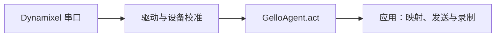

# 架构与数据流

## 库的边界

`DynamixelDriver` 负责电机通信与读取线程；`DynamixelRobot` 应用 offset、方向、夹爪归一化和起始多圈参考；`GelloAgent` 提供上游 `act(obs)` 接口。应用拥有实例，必须调用 `close()`。真实模式在驱动或初始化失败时上报错误并释放已创建资源。

PiPER-X 应用在 controller 中组合本库和 SDK，并记录 raw；converter 独立处理时间对齐和 LeRobot 输出。库不导入这两个项目。`commands/` 中保留的通用上游实验仍可以自行创建机器人与相机节点；它们不是 PiPER-X 的入口。

## 配置与资源

新应用显式创建 `DynamixelRobotConfig`。库独立 `read` 使用 `PORT_CONFIG_MAP`；YAML 工具使用 `configs/`。三种配置来源不会自动同步。本机 PiPER-X 校准以 controller 的 TOML 为准。

仿真和 FACTR 使用源码 checkout 中的模型、配置和 URDF。wheel 安装不会代替资源 checkout；使用 `GELLO_PROJECT_ROOT` 和 `GELLO_MENAGERIE_ROOT` 指向资源。

## 文档导航

- [安装](installation.md)
- [CLI](reference/cli.md)
- [设备配置](reference/config.md)
- [排障](reference/errors.md)
- [贡献指南](../CONTRIBUTING.md)
- [上游差异](UPSTREAM.md)
- [上游说明存档](OFFICIAL.md)
- [ROS2](../ros2/README.md)

## 来源与许可

GELLO 来源为 [wuphilipp/gello_software](https://github.com/wuphilipp/gello_software)，保留 [MIT 许可与 Philipp Wu 版权声明](../LICENSE)。FACTR 部分来源于 [factr_teleop](https://github.com/RaindragonD/factr_teleop/)，其 Apache-2.0 来源说明保留在上游说明存档中。MuJoCo Menagerie、ROS2 子组件和依赖适用各自许可；发布时保留相应声明，不将仓库 MIT 文本视为这些组件的替代许可。
