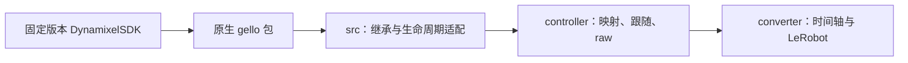

# 架构与数据流

## 上游与本地适配

`gello.*` 是原始上游命名空间。`agilex_gello_software.*` 是本地扩展，两者由同一个 uv 项目安装。上游脚本、配置和 ROS2 不再改用本地包名；它们继续按上游路径工作。`uv build` 使用 Hatchling 将 `gello/` 与 `src/agilex_gello_software/` 同时打包。

本地 `GelloAgent` 继承原生 agent 的 `act()`，配置适配器注入本地 robot；robot 继承原生状态映射、夹爪归一化和滤波，替换驱动并保留多圈参考对齐。驱动继承原生命令协议，只在 `src/` 管理初始化、串口策略、反馈读取和关闭。不替换原生模块或全局类。

## 运行边界

| 入口 | 行为 |
| --- | --- |
| 本地 `agilex-gello-software read` | 真实读取、库端口表、失败上报、结束后关闭 |
| controller 的 read/follow/record | 应用 TOML 校准、本地适配、主从映射与完整退出流程 |
| 本地 CLI 的通用命令 | 转发原始 `experiments/`，切换到 checkout 根目录解析相对资源 |
| 直接 `gello.*` 或上游脚本 | 原生上游行为，不自动使用本地驱动保护 |

原生驱动保留其自动处理占用串口、fake fallback 和等待策略。本地驱动禁用 fake fallback，不自动杀进程/改权限；首帧等待默认 3 秒，缓存超过 1 秒拒绝返回，连续 10 次通信失败或缺少完整反馈会报错。读取周期等待为 0.01 秒，不代表实际采样率。

本地关闭会停止线程，等待最多 2 秒后关闭串口，必要时再等待 1 秒；仍未停止时报错。应用必须调用 `close()`，初始化失败也释放已获得的资源。

## 配置与文档

controller 的设备校准不写入上游端口表。已有本机生成 YAML 与 arena 迁入 `src/agilex_gello_software/configs/legacy/` 作历史参考；原始 `configs/` 与上游相同。通用实验的数据格式不是 controller raw v1。

- [当前项目快速开始](../README.md)
- [安装](installation.md)
- [CLI](reference/cli.md)
- [配置](reference/config.md)
- [排障](reference/errors.md)
- [贡献指南](../CONTRIBUTING.md)
- [上游基线与审计](UPSTREAM.md)
- [上游开发说明](OFFICIAL.md)

保留 [MIT 版权](../LICENSE)。DynamixelSDK 使用其 [Apache-2.0 许可](../third_party/DynamixelSDK/LICENSE)，FACTR、ROS2 与模型继续适用对应组件许可；完整来源保留在上游说明中。
